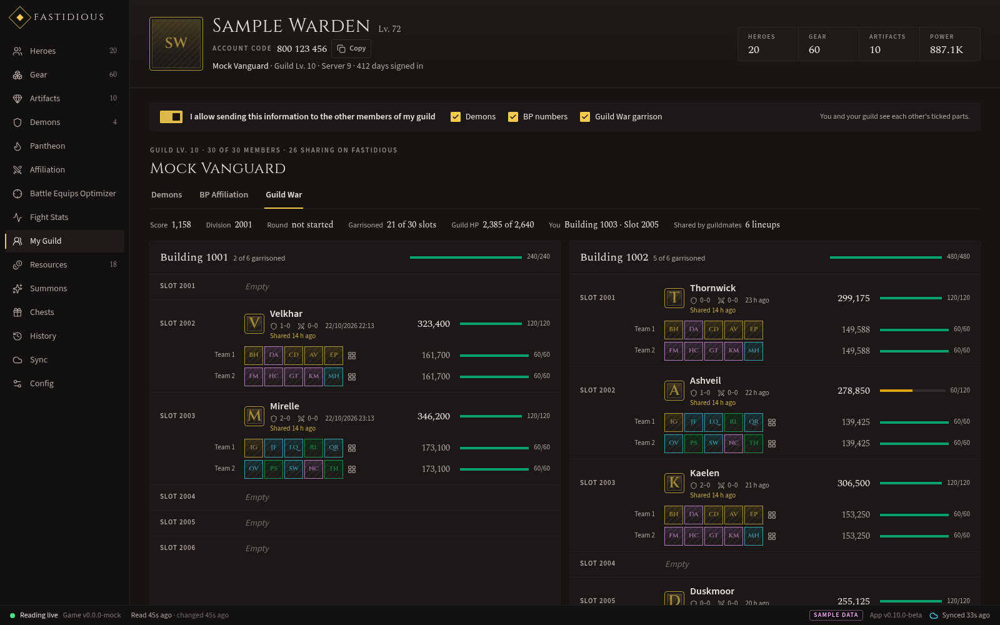
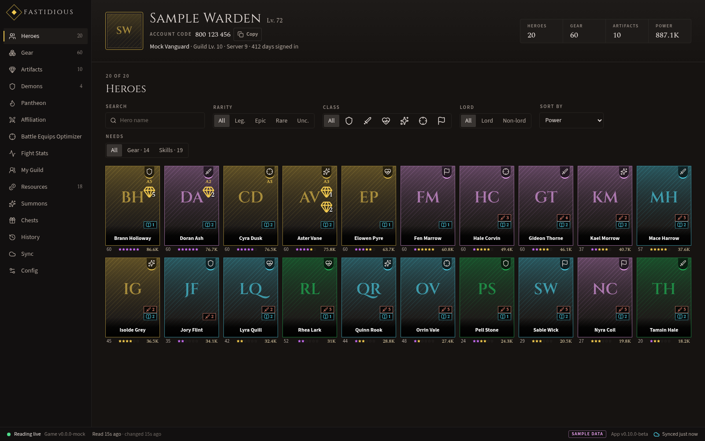
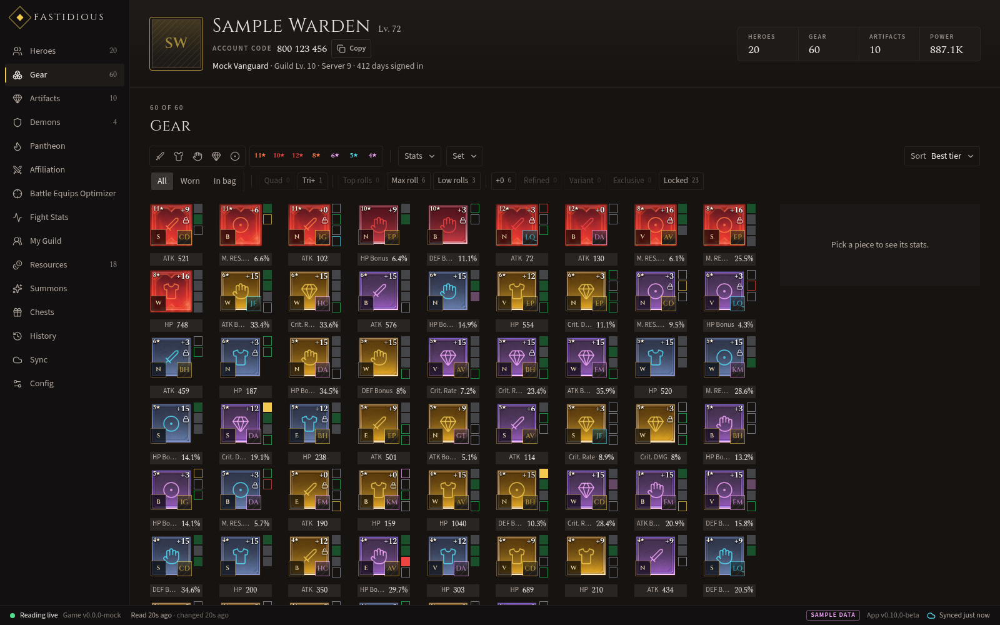
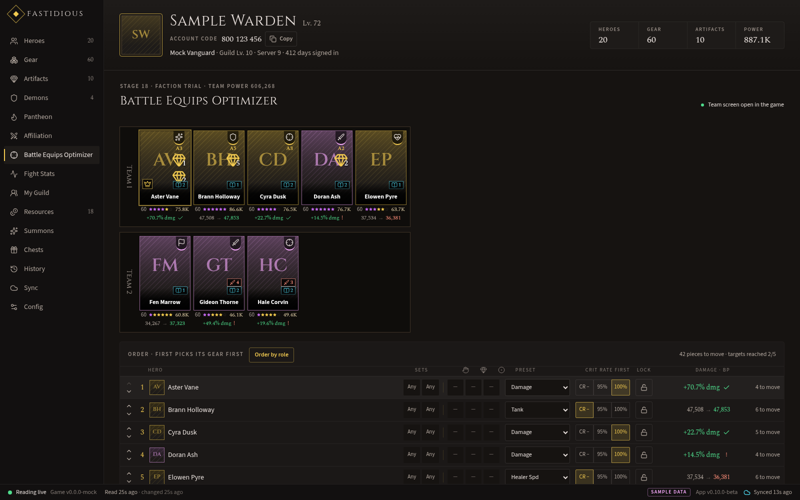
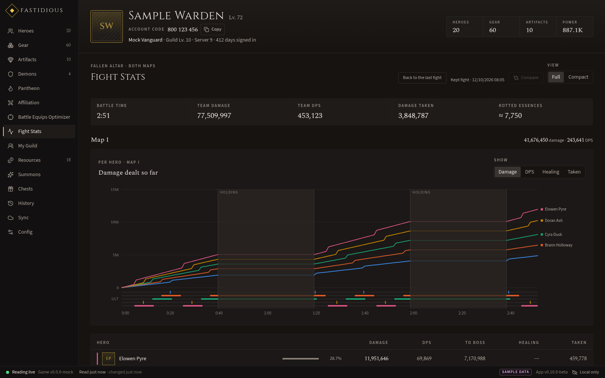
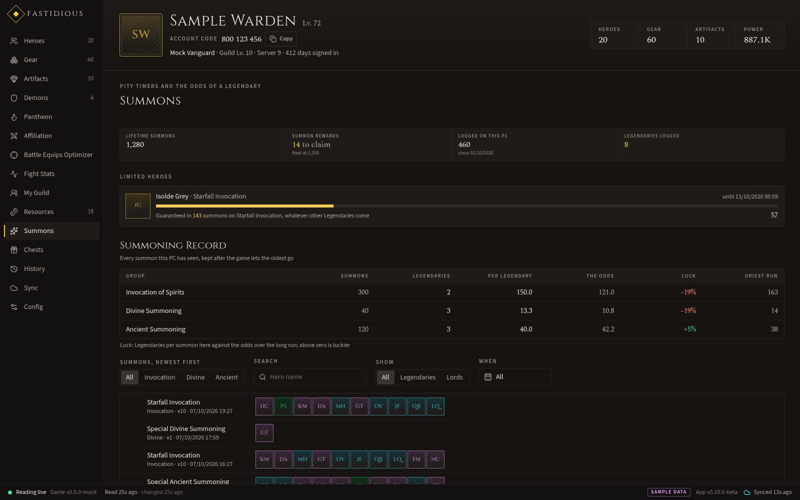
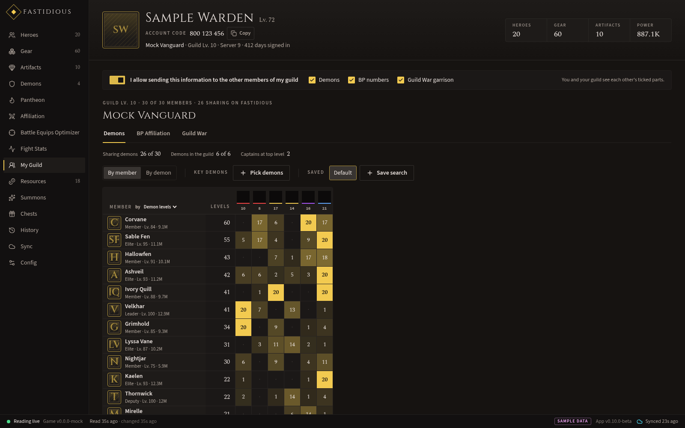
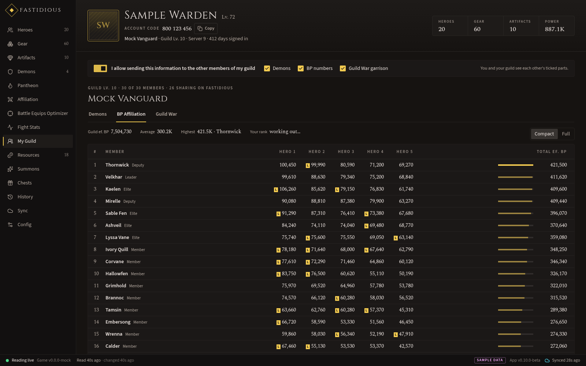
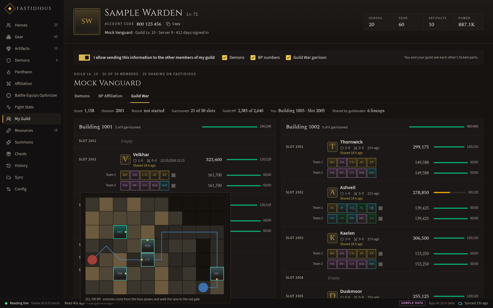

# Fastidious Client

**The desktop companion for Watcher of Realms, from [fastidious.gg](https://fastidious.gg).**

Your whole account on your own PC, live while you play: every hero, piece of gear and artifact, your demons, your
summon pity, your fights and your guild. The app reads it from the running game and shows it in one window that keeps
up as you play. It is read-only: it never changes anything in the game and never reads your screen.

**Download:** [Windows installer](https://github.com/danielarcher/fastidious-client-releases/releases/latest/download/Fastidious-Client_x64-setup.exe)
· [Linux](https://github.com/danielarcher/fastidious-client-releases/releases/latest/download/Fastidious-Client_linux-x86_64)
· [all releases and what's new](../../releases)

All pictures show the app's sample account, made up for previews.

---

## What it does

**Your account**
- **Heroes**: every hero as its full card, with level, stars, awakening, skills, gear and the stat sheet the game
  shows, plus what each still needs (empty gear slots, skills to level). Filter by class, faction, rarity and lords.
- **Gear**: the bag as the game draws it, with tags that find what matters (**Quad**, **Tri+**, **Top rolls**, **Max
  roll**, …), substat filters that sort by the best rolls, and each piece's card on hover.
- **Artifacts, Demons, Pantheon, Resources** and a **History** of your account over time, kept on your PC.

| Heroes | Gear |
|---|---|
|  |  |

**Building teams**
- **Affiliation**: finds the best builds for a team from the gear you own, and which upgrades (recasting,
  transmutation, variant gems) would lift it most.
- **Battle Equips Optimizer**: plans gear for a whole battle team at once, no piece used twice, with presets per hero
  (including a **Damage** preset that follows the game's own damage rules) and locks you control. The app shows
  each build and where every piece comes from; you equip it in the game yourself.

**Fights**
- **Fight Stats**: live during a fight, each hero's damage, DPS, healing and damage taken over battle time, the
  formation on its board, and ultimates as they land. Every fight is kept, so you can compare runs of the same stage
  side by side, even while a new one is running.

**Summons and chests**
- **Summons**: your pity for every summon type, the chance on the next pull and within the next ten, banner
  guarantees, and a summon record kept beyond the game's own list.
- **Chests**: a log of guild boss chest claims, with drop rates and totals over every claim.

**My Guild**
- **Demons** and **BP Affiliation**: what guildmates who use Fastidious share, side by side.
- **Guild War**: your guild's buildings, each slot's defender and the HP each team has left, with formations on the
  map. Members who share their garrison see the guild's lineups without opening each building.

| Demons | BP Affiliation |
|---|---|
|  |  |

## Your data

- **Nothing leaves your PC** unless you link the app with your fastidious.gg account (Sync, optional).
- Linked, a sync fills **My Heroes, My Demons and My Realm** on fastidious.gg: your roster, demon levels, summon pity,
  chest claims, guild and server. Gear, artifacts and resources stay on your computer.
- **Guild sharing** is off until you turn it on, part by part (demons, BP, Guild War garrison). You only see a part of
  your guild while you share it too, and turning it off removes yours at once.

## Install

**Windows 10 or 11 (64-bit)**
1. Download the [installer](https://github.com/danielarcher/fastidious-client-releases/releases/latest/download/Fastidious-Client_x64-setup.exe) and run it.
2. The installer isn't code-signed during the beta, so Windows SmartScreen may warn: click **More info**, then
   **Run anyway**.
3. The app asks to run as administrator: the game runs elevated, and the app needs the same rights to read it.

**Linux (x86-64)**: the app reads the game running under Proton.
1. Download the [binary](https://github.com/danielarcher/fastidious-client-releases/releases/latest/download/Fastidious-Client_linux-x86_64),
   make it executable (`chmod +x Fastidious-Client_linux-x86_64`) and run it.
2. It needs WebKitGTK 4.1 (`webkit2gtk-4.1`), which most desktops already have.

## Updates

The app updates itself from this page: it checks when it starts and every few hours, and installs a new version when
it won't interrupt a fight or a summon. **Config** shows the version, what's new and an **Update now** button, and
lets you turn automatic installs off.

Every file is signed with the app's update key, and the app refuses any update whose signature doesn't match.
`SHA256SUMS.txt` in each release lists the files' hashes if you want to check a download by hand
(`sha256sum -c SHA256SUMS.txt`).

## About this repository

It holds only the release files: the installers, their update signatures and `latest.json`, which the app reads to
find updates. The source code is not published. Questions, bugs and ideas: [fastidious.gg](https://fastidious.gg).
